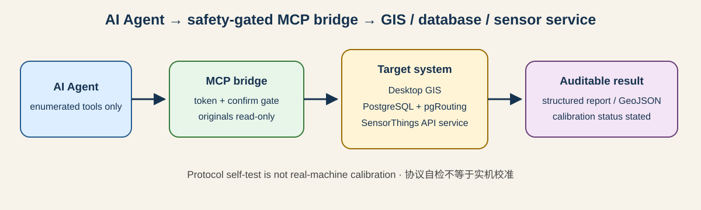

# gis-agent-bridges

[](LICENSE)
[](https://glama.ai/mcp/servers/YUYU20061107/gis-agent-bridges)

English version: [`README.en.md`](README.en.md)

A family of small, safety-gated bridges that let AI agents operate mainstream
GIS software — headless inventory/backup plus, where the vendor API allows, a
live in-app MCP bridge — all in one repo for easy reuse.



一个把主流 GIS 软件的「AI Agent 桥」收在一起的合集仓库：每个软件一个子目录，
形态统一为两种——**无头桥**（在软件进程外盘点、备份工程文件，只对副本动手），
以及在厂商 API 允许时的**应用内实时 MCP 桥**（桥脚本跑在软件进程内，Agent
经 MCP 协议操作你当前正打开的工程）。所有写操作都带确认闸，所有能力都如实标注。
目前合集共 **16 个包、127 个 MCP 工具**：9 个桌面软件桥、5 个消费侧只读桥
（pgRouting、istSOS、PostGIS、GeoServer、STAC），以及 GRASS GIS、GDAL
两个无头工具桥。

## 项目由来

这两年，CAD、Blender 等工科软件陆续出现让 AI Agent 直接接入、操作当前工程
的服务，GIS/遥感这边基本还是空白。这个仓库想把主流 GIS 软件的桥都做出来、
放在一起，方便有需要的人直接取用——不管你手头是国产的 SuperMap、MapGIS，
还是 Esri 的 ArcGIS、开源的 QGIS，或是 ENVI、FME 这类处理工具。

## 软件矩阵

| 软件 Software | 目录 Directory | 形态 Form | MCP 工具数 Tools | 状态 Status |
|---|---|---|---|---|
| SuperMap iDesktopX | `supermap/` | 实时＋无头 | 13 | 整包 v0.4（live server 0.3.0，两者区别见 `docs/VERSIONING.md`）· 文件回退模式已实机校准（iDesktop 10i，13/13）；iDesktopX 实时待验证；v0.4 增补工程文件生产手册、三维场景资产与验收脚本 |
| ArcGIS Pro | `arcgis-pro/` | 实时＋无头 | 13 | v0.2 · 已对齐 SuperMap 校准通用升级（selftest 线程读、token 文件环境变量、verify_project 盘点脚本、ENGINEERING-PLAYBOOK）、未实机校准 |
| ArcMap（Esri 已退役，个人自用向） | `arcmap/` | 实时＋无头 | 10＋无头 6 动作 | v0.3 · 无头桥已实机校准（Desktop 10.8 / Python 2.7.16，2026-10-25；三只读＋三受控写、py2 编码两坑已修）；实时桥未实机校准 |
| QGIS | `qgis/` | 实时＋无头 | 12 | v0.2 · 已对齐 SuperMap 校准通用升级（selftest 线程读、token 文件环境变量、verify_project 盘点脚本、ENGINEERING-PLAYBOOK）、未实机校准 |
| GeoScene Pro（易智瑞） | `geoscene/` | 实时＋无头（ArcGIS Pro 同源衍生） | 13 | v0.2 · 已对齐 SuperMap 校准通用升级（selftest 线程读、token 文件环境变量、verify_project 盘点脚本、ENGINEERING-PLAYBOOK）、兼容性待实机核验、未实机校准 |
| MapGIS（中地数码） | `mapgis/` | 探针＋无头骨架 | 3 | 探索版 v0.2 · 已对齐 SuperMap 校准通用升级（selftest 线程读、token 文件环境变量、verify_project 盘点脚本、ENGINEERING-PLAYBOOK）、实时接口未证实、未实机校准 |
| ENVI（NV5） | `envi/` | 仅无头 | 7 | v0.2 · 已对齐 SuperMap 校准通用升级（selftest 线程读、verify_project 盘点脚本、ENGINEERING-PLAYBOOK；本包无 token 文件）、idlpy 待实机、未实机校准 |
| Global Mapper（Blue Marble） | `globalmapper/` | 无头＋脚本半实时 | 7 | v0.2 · 已对齐 SuperMap 校准通用升级（selftest 线程读、verify_project 盘点脚本、ENGINEERING-PLAYBOOK；本包无 token 文件）、API 签名待探针、未实机校准 |
| FME（Safe Software） | `fme/` | 仅无头 runner | 6 | v0.2 · 已对齐 SuperMap 校准通用升级（selftest 线程读、verify_project 盘点脚本、ENGINEERING-PLAYBOOK；本包无 token 文件）、与官方 Flow MCP 互补、未实机校准 |
| pgRouting（OSGeo） | `pgrouting/` | 仅消费侧只读（stdio，无常驻桥） | 5 | v0.1 · 固定参数化模板调 pgr_dijkstra 取路径/统计/导出 GeoJSON，无任意 SQL 入口；协议自检 12/12（假 psql 替身）、未实机校准（无 PostgreSQL+pgRouting 环境）；非 pgRouting 官方组件 |
| istSOS（OGC SensorThings API） | `istsos/` | 仅消费侧只读（stdio，无常驻桥） | 6 | v0.1 · STA 只读工具组（Things/Datastreams/观测/GeoJSON 导出，条数与分页硬上限）；协议自检 12/12（本地假 STA 服务端）、istSOS4 本体未实测；非 istSOS 官方组件 |
| PostGIS（PostgreSQL 空间扩展） | `postgis/` | 仅消费侧只读（stdio，无常驻桥） | 6 | v0.1 · 固定 SQL 模板经 psql 子进程只读探查空间表（清单/结构/概览/GeoJSON 导出，允许表集合＋导出硬上限），无任意 SQL 入口；协议自检 13/13（假 psql 替身）、未实机校准（无 PostgreSQL+PostGIS 环境）；非 PostGIS 官方组件 |
| GeoServer（OGC 地图服务器） | `geoserver/` | 仅消费侧只读（stdio，无常驻桥） | 6 | v0.1 · REST 目录只读工具组（工作区/图层清单/图层详情/WMS·WFS 能力摘要，GET-only、认证仅经环境变量、同源跟随防 SSRF）；协议自检 12/12（本地假 GeoServer 服务端）、未实机校准；非 GeoServer 官方组件 |
| STAC API（时空资产目录） | `stac/` | 仅消费侧只读（stdio，无常驻桥） | 6 | v0.1 · STAC API 只读检索工具组（集合清单/集合详情/条目检索/GeoJSON 导出，bbox 本地校验、条数硬上限、资产只报键名不下载）；协议自检 13/13（本地假 STAC 服务端）、未实机校准；非官方组件 |
| GRASS GIS（OSGeo） | `grass-gis/` | 仅无头批处理（stdio，无常驻桥） | 7 | v0.1 · 固定模板调 `grass --exec`（列图层/栅格信息只读；坡度坡向/晕渲/重采样三作业与矢量导出走 confirm 闸、绝不传 --overwrite）；协议自检 15/15（假 grass 替身＋假 location）、未实机校准（无 GRASS GIS 环境）；非 GRASS GIS 官方组件 |
| GDAL/OGR（OSGeo） | `gdal/` | 仅无头工具（stdio，无常驻桥） | 7 | v0.1 · 固定模板调 gdalinfo/ogrinfo 只读探查与 gdal_translate/ogr2ogr 转换（无原始选项透传、子进程强制 GDAL_PAM_ENABLED=NO 防 .aux.xml、转换走 confirm 闸只写新文件）；协议自检 15/15（四假二进制替身）、未实机校准（无 GDAL 环境）；非 GDAL 官方组件 |

## 统一设计原则

- **只在本机**：应用内桥只监听 127.0.0.1，每次启动生成随机 token，
  请求必须带对 token 才执行。token 有两种传递方式：桌面包由 MCP
  服务端自动读取本地 token 文件，**用户不需要手抄 token**；
  pgRouting/istsos 消费桥与 postgis、geoserver、stac、grass-gis、
  gdal 五个新包都是直接 stdio 服务，工具调用参数须附当前
  `_token`（见各包 README）。
- **写操作 confirm 闸门**：内容级写工具缺 `confirm=true` 一律拒绝执行；
  confirm 只能在用户明确同意后填入，Agent 不许自作主张绕过。
- **原件只读**：盘点与任何写需求都先 backup、只改副本，原件零写入。
- **不提供任意代码执行工具**：Agent 能做的事被限定在可枚举、可审计的
  工具集合内，没有 eval/exec 外部输入、任意脚本或任意处理工具调用的通道。
- **能力如实标注**：接入方式分模式回报——file-fallback 不冒充实时接入；
  无头模式只能读已保存状态；探针未证实的接口不假装存在，返回结构化错误
  并附现场线索。
- **先校准后使用**：每个包自带校准指南 `docs/CALIBRATION.md`，给出从探针
  钉死接入策略、只读工具逐项对界面、写操作只在副本上验的完整顺序与验收标准。

## 端口分配

| 端口 | 软件 |
|---|---|
| 47615 | SuperMap iDesktopX |
| 47616 | ArcGIS Pro |
| 47617 | ArcMap |
| 47618 | QGIS |
| 47619 | GeoScene Pro |

MapGIS、ENVI、Global Mapper、FME、pgRouting、istSOS、PostGIS、GeoServer、STAC、GRASS GIS、GDAL 无常驻应用内桥，不占端口。

## 快速开始

**第 0 步：拿到仓库。**

```bash
git clone https://github.com/YUYU20061107/gis-agent-bridges.git
cd gis-agent-bridges
```

不用 Git 也可以在 GitHub 页面 `Code → Download ZIP` 下载解压。
本仓代码是纯 Python 标准库，**没有第三方依赖要装**。

**先跑通（约 1 分钟，不需要任何 GIS 软件）：**

```bash
python scripts/quickstart.py --list
python scripts/quickstart.py --package qgis --selftest
python scripts/quickstart.py --sample-qgis
```

第一条列出 16 个包与工具数；第二条跑指定包的离线协议自检；第三条用
仓内合成样本工程验证无头解析（样本在 `examples/sample-data/`）。
Windows 可改用 `scripts/quickstart.ps1`，macOS/Linux 可用
`scripts/quickstart.sh`。

**再正式接入：**

1. 生成客户端配置片段：
   `python scripts/quickstart.py --package <包名> --print-config`，
   配置文件落点见 `docs/CLIENTS.md`。
2. 读目标包的 `README.md` 与 `SKILL.md`，弄清形态、工具清单与边界；
   桌面实时桥按包内 live 说明在软件里启动桥（多数包是 `live/LIVE.md`，
   ENVI 为 `live/HEADLESS.md`、FME 为 `live/RUNNER.md`）。
3. 按该包 `docs/CALIBRATION.md` 在真实软件上完成实机校准，通过后再
   正式使用。**自检通过不等于校准完成。**

常见报错见 `docs/TROUBLESHOOTING.md`；提 Issue/校准报告请用仓库的
Issue 模板，贡献方式见 `CONTRIBUTING.md`。

### Python 版本

| 范围 | 要求 |
|---|---|
| 仓库级工具（quickstart、manifest 校验、CI） | Python 3.11+（CI 用 3.11，各包自检亦在此口径验证） |
| 多数 stdio MCP 服务端 | 可运行于任意 Python 3（纯标准库、无第三方依赖）；仓库自检与 CI 的验证口径为 3.11+，**建议 3.11+**——各包文档里的「任意 Python 3」指可运行下限，与此不冲突 |
| SuperMap 无头桥 | 厂商运行时 Python 3.5.4＋iobjectspy（专用环境，见该包文档） |
| ArcMap 桥 | ArcGIS 自带 Python 2.7.16 |
| 其余桌面实时桥 | 随宿主 GIS 软件的内嵌解释器，见各包 README |

## 客户端接入示例（examples/）

根目录 `examples/` 是跨包总入口（第一次试用路径＋合成样本数据）。
每个包也都带一份可直接复制的接入示例：

- `<包>/examples/mcp-client-config.json`：MCP 客户端配置片段，合并进你所用
  客户端（Claude Desktop / Cursor / Trae 等）的 `mcpServers` 段，把占位符
  `<ABSOLUTE_PATH_TO_PACKAGE>` 换成**仓库根目录**在你机器上的绝对路径即可
  （或用 `scripts/quickstart.py --print-config` 自动替换）。
- `<包>/examples/prompts.md`：2–3 条可直接对 Agent 说的提示词示例（只读
  盘点、导出、以及一条会触发 confirm 闸的写操作），并写明各自的预期行为。

工具清单的机读版本在 `manifest/tools-manifest.json`（由
`manifest/build_manifest.py` 从各包服务端实启探测生成，勿手改）；
版本口径见 `docs/VERSIONING.md`，变更记录见 `CHANGELOG.md`；
安全模型与漏洞报告方式见根目录 `SECURITY.md`（英文版
`SECURITY.en.md`）。

## 校准证据

本仓的每条能力结论按三级证据认定，**不跨级引用**：

| 级别 | 含义 |
|---|---|
| **实机校准** | 在真实厂商软件上按校准工单逐项跑通，数值与环境见下表 |
| **协议自检** | 无厂商软件环境中验证协议层（initialize / 工具清单 / 保存闸门 / 错误 token 拒绝）与无头文件层（备份真复制、盘点结构化报错） |
| **未证实** | 接口未经探针或实机确认，桥只返回结构化错误与现场线索，不假装可用 |

### SuperMap（实机校准 · 文件回退模式，2026-10-24）

- **环境**：iDesktop 10i(2020) 10.1.0；iObjects Java 10.1.0.19113；
  iobjectspy 10.1.0.0；Python 3.5.4；OpenJDK 1.8.0_232；Sentinel LDK
  许可冒烟通过。校准机无 iDesktopX，实时对象不可得。
- **方法**：按 `supermap/docs/CALIBRATION.md` 工单执行；无头三件套
  （preflight / backup / inspect）＋文件回退桥 13 个工具逐项验收；
  写类工具只在带时间戳的工作空间**副本**上以 `confirm=true` 验证，
  保存后重开副本复核改动持久性，并核对原件 mtime 全程未变。
- **结果**：13/13 工具可用；导出图 1200×900 PNG 真实落盘；协议层自检
  `live/selftest.py` 在 Windows 下 6/6 PASS。2026-10-28 在另一台机器的
  全新克隆上复跑 preflight，`iobjectspy_import`、`license_smoke` 均 ok。
  完整记录：`supermap/docs/CALIBRATION-RESULTS-20261024.md`。

### ArcMap（实机校准 · 无头桥，2026-10-25）

- **环境**：ArcMap Desktop 10.8；Python 2.7.16（ArcGIS 自带）。
- **方法**：无头桥三项只读＋三项受控写逐项验收；另以 lab2 地理配准
  流水线做回归基线。实机发现的五项缺陷（py2 编码两坑、Warp 不可用、
  Describe 残缺、无头导出色调异常）及处置已回写
  `arcmap/docs/CALIBRATION.md`。
- **结果**：回归基线——控制点 7 个，一次多项式 RMS **2.3884 m**、
  max 3.6348 m，像元 0.9165×0.9235 m；矢量 5 层
  `features_written == features_counted`。

### 局限

- 上述结论**只对所列环境与版本组合成立**；换版本、换许可形态须重新校准。
- 文件回退模式操作的是副本，**界面不刷新，不等于实时接入**；全部实时
  （应用内）模式目前最高只到「协议自检」级。
- 未列入上表的包（ArcGIS Pro、QGIS、GeoScene、MapGIS、ENVI、
  Global Mapper、FME、pgRouting、istSOS、PostGIS、GeoServer、STAC、
  GRASS GIS、GDAL）均未实机校准，不要把任何一个包/模式的结论
  套到另一个上。

## 状态与诚实声明

各包的校准状态**以上方软件矩阵、校准证据与各包 README 为准，按模式
分别认定**，不要一概而论。使用前请先按各包校准指南完成校准——
**不要把"协议自检通过"理解为"已与真实软件对接成功"**。

## 许可与免责

- 本仓库代码以 MIT 许可证发布（见根目录 `LICENSE`，各子包亦各带一份）。
- 本项目与 SuperMap、Esri、易智瑞、中地数码、NV5、Blue Marble Geographics、
  Safe Software 等厂商均无隶属关系，软件名称仅用于指明对接对象。
- 使用各桥需自备对应软件的正版许可；桥本身不包含、不分发任何厂商组件。
